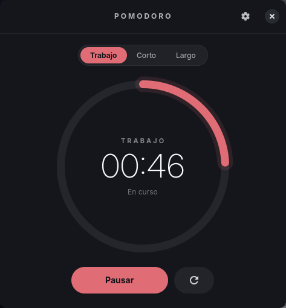
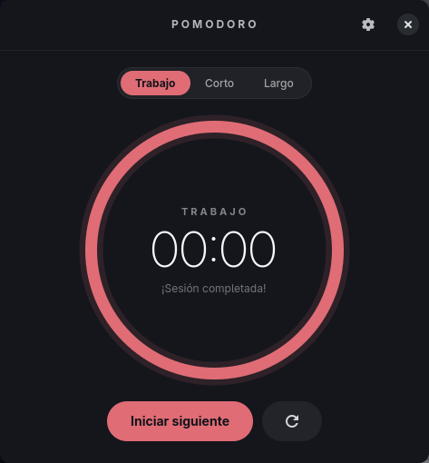
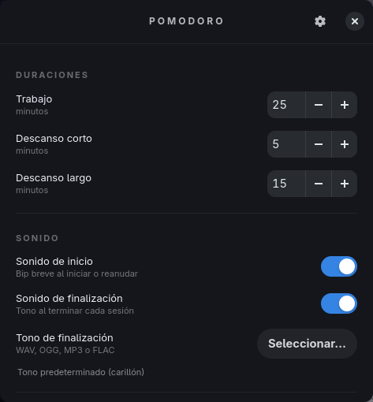
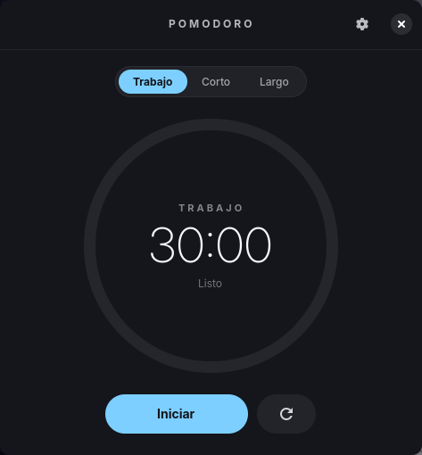

# Pomodoro Timer

Reloj **Pomodoro** de escritorio para Linux: ligero, nativo y con una
interfaz minimalista. Escrito en **Rust + GTK4**, funciona en **Wayland** y
**X11**, usa **sonidos locales** (sin Internet) y guarda sus ajustes siguiendo
la **XDG Base Directory Specification**.



| Sesión completada | Ajustes | Acoloreado |
|---|---|---|
|  |  |  |

---

## Características

- Tres modos: **Trabajo** (25 min), **Descanso corto** (5 min) y **Descanso
  largo** (15 min), todos configurables.
- Controles de **iniciar / pausar / reanudar / reiniciar** y cambio de modo.
- Anillo de progreso animado y números grandes para el tiempo restante.
- **Sonido de inicio** sintetizado (bip breve) que funciona sin configurar nada.
- **Sonido de finalización** personalizable mediante el **diálogo nativo de
  archivos** de GTK (compatible con Wayland vía `xdg-desktop-portal`) y
  previsualización.
- **Notificaciones de escritorio** mediante el protocolo estándar.
- Paleta oscura y sobria con **color de acento configurable**.
- Guarda las preferencias entre ejecuciones (no se pierden al cerrar).
- Sin telemetría ni conexiones de red.
- La interfaz **nunca se bloquea**: el audio y las operaciones auxiliares corren
  en hilos aparte.

---

## Requisitos (Arch Linux)

```bash
sudo pacman -S --needed base-devel gtk4 alsa-lib libnotify
```

- `gtk4` (≥ 4.10; se probó con 4.24) — interfaz y diálogo de archivos nativo.
- `alsa-lib` — salida de audio (PipeWire/PulseAudio vía `pipewire-alsa`).
- `libnotify` — el binario `notify-send` para las notificaciones.
- `cargo`/`rustc` — para compilar.

Opcional en tiempo de ejecución: un demonio de notificaciones (cualquier
escritorio moderno lo incluye) y `xdg-desktop-portal` + backend (`gtk` o
`hyprland`) para el selector de archivos en Wayland.

## Compilar y ejecutar

```bash
# Depuración
cargo run

# Optimizado (LTO, binario ~1,4 MB)
cargo build --release
./target/release/pomodoro-timer
```

Con `make`:

```bash
make release     # compila optimizado
make run         # ejecuta
make test        # pruebas unitarias
make clippy      # análisis estático (avisos = errores)
make install     # instala en /usr/local (usa PREFIX= para cambiarlo)
make uninstall
```

### Diagnóstico de audio

Comprueba que el audio funciona sin abrir la ventana:

```bash
pomodoro-timer --audio-test                 # bip + carillón por defecto
pomodoro-timer --audio-test ~/mi-tono.ogg   # bip + tu fichero
```

## Instalación

```bash
sudo make install          # /usr/local
# o
make install PREFIX=$HOME/.local
```

Instala el binario, la entrada `io.github.pomodoro.PomodoroTimer.desktop` y el
icono en `hicolor/scalable/apps`. Tras ello la aplicación aparece en el
lanzador de aplicaciones.

### Paquete para Arch (`PKGBUILD`)

Se incluye un `PKGBUILD`. Crea el tarball del código y compílalo con `makepkg`:

```bash
tar -czf pomodoro-timer-0.1.0.tar.gz \
  --transform 's,^,pomodoro-timer-0.1.0/,' \
  pomodoro-timer/{Cargo.toml,Cargo.lock,src,assets,LICENSE}
makepkg -si
```

Para empaquetado **sin red**, vendoriza antes las dependencias de Rust
(`cargo vendor`) como se indica en los comentarios del `PKGBUILD`.

---

## Configuración

Los ajustes se guardan en:

```
$XDG_CONFIG_HOME/pomodoro-timer/settings.toml   # o ~/.config/pomodoro-timer/settings.toml
```

Nunca se escribe en rutas del sistema que requieran privilegios. Ejemplo:

```toml
work_minutes = 25
short_break_minutes = 5
long_break_minutes = 15
start_sound = true
finish_sound = true
finish_sound_file = "/home/usuario/tonos/campana.ogg"
auto_start_next = false
run_in_background_on_close = false
accent = "#e06c75"
```

| Opción | Descripción | Rango / valores |
|---|---|---|
| `work_minutes` | Duración del trabajo | 1–240 |
| `short_break_minutes` | Duración del descanso corto | 1–240 |
| `long_break_minutes` | Duración del descanso largo | 1–240 |
| `start_sound` | Bip al iniciar o reanudar | `true`/`false` |
| `finish_sound` | Tono al finalizar | `true`/`false` |
| `finish_sound_file` | Tono personalizado | ruta o ausente |
| `auto_start_next` | Inicia el siguiente periodo solo | `true`/`false` |
| `run_in_background_on_close` | Oculta la ventana al cerrar en vez de salir | `true`/`false` |
| `accent` | Color de acento | `#rrggbb` |

**Tolerancia a fallos:** si el fichero no existe, está corrupto o tiene valores
fuera de rango, la aplicación arranca igualmente con valores por defecto (el
fichero corrupto se conserva como `settings.toml.corrupt`). Todos los valores se
validan al cargar.

---

## Uso

1. Elige el modo con el selector **Trabajo / Corto / Largo**.
2. Pulsa **Iniciar**. El anillo y la cuenta atrás comienzan.
3. **Pausar** detiene la cuenta conservando el tiempo; **Reanudar** continúa sin
   desviación (se usa un reloj monotónico, no un contador por segundo).
4. Al terminar: suena el tono, aparece una notificación y el botón cambia a
   **Iniciar siguiente** (el cambio automático es opcional, desactivado por
   defecto).
5. En **Ajustes** (⚙) cambia las duraciones, los sonidos, el tono de
   finalización y el color de acento.

### Elegir un tono de finalización

Pulsa **Seleccionar…** → se abre el diálogo nativo de archivos → elige un
`.wav`, `.ogg`, `.oga`, `.mp3` o `.flac`. La ruta se guarda y se usa en las
siguientes sesiones. Con **Previsualizar** lo escuchas y con el botón ⟲
restauras el tono por defecto. Si el archivo desaparece, la aplicación avisa de
forma discreta y usa el tono predeterminado sin bloquearse.

---

## Integración con Linux

| Aspecto | Comportamiento |
|---|---|
| Wayland / X11 | Detectado automáticamente por GTK4 (GDK). Probado en Hyprland/Wayland. |
| Diálogo de archivos | `GtkFileDialog` nativo (portal en Wayland). No se implementa explorador propio. |
| Notificaciones | `notify-send` (protocolo `org.freedesktop.Notifications`). |
| Escalado / fuentes | Gestionados por GTK4 (respeta el factor de escala del compositor). |
| Configuración | XDG Base Directory. |
| Consumo | Redibujo a 250 ms solo mientras corre; el anillo no se repinta en reposo. |
| Cierre | Sin procesos huérfanos. En segundo plano, relanzar la app recupera la ventana (instancia única). |

### Gestores de ventanas dinámicos (tiling)

En un WM de mosaico (Hyprland, sway, …) la ventana se colocará en mosaico salvo
que definas una regla de flotación. Ejemplo para **Hyprland**:

```
windowrule = float, class:^(io\.github\.pomodoro\.PomodoroTimer)$
windowrule = size 380 620, class:^(io\.github\.pomodoro\.PomodoroTimer)$
windowrule = center, class:^(io\.github\.pomodoro\.PomodoroTimer)$
windowrule = pin, class:^(io\.github\.pomodoro\.PomodoroTimer)$
```

En **sway**:

```
for_window [app_id="io.github.pomodoro.PomodoroTimer"] floating enable
for_window [app_id="io.github.pomodoro.PomodoroTimer"] resize set 380 620
```

---

## Arquitectura

```
src/
├── main.rs           Punto de entrada, GtkApplication y diagnóstico de audio
├── timer.rs          Máquina de estados del temporizador (lógica pura, sin E/S)
├── config.rs         Ajustes, validación y persistencia XDG (TOML, escritura atómica)
├── audio.rs          Motor de audio en hilo dedicado (rodio; síntesis del bip)
├── notifications.rs  Notificaciones de escritorio (notify-send, en hilo aparte)
├── theme.rs          CSS de GTK4 y utilidades de color/acento
└── ui.rs             Ventana, anillo (Cairo), ajustes y cableado de señales
```

Cada responsabilidad está aislada: la lógica temporal no conoce GTK, la
persistencia no conoce la interfaz y el audio no bloquea al usuario.

### Elección tecnológica

Se compararon las alternativas habituales para una utilidad de escritorio en
Linux:

| Opción | Valoración |
|---|---|
| **GTK4 + Rust** ✅ | Nativo en Wayland y X11; `GtkFileDialog` nativo; Cairo para el anillo; memoria y CPU bajas; binario pequeño; gestión de errores segura. Ideal para Arch. |
| Qt (C++/Python) | Potente, pero añade un runtime mayor (y PySide6 no venía instalado). Más peso para un temporizador. |
| Tauri (webview) | Requiere WebKitGTK, mayor consumo de RAM/CPU y diálogos dependientes del portal; sobredimensionado. |
| JS/Electron | Descartado por consumo y por no ser nativo. |

**Elegido: GTK4 + Rust**, por su equilibrio entre rendimiento, integración con
Wayland, diálogos nativos, reproducción de audio y mantenibilidad en Arch.

### Audio

- **Inicio:** bip senoidal de 880 Hz y ~120 ms sintetizado en memoria (sin
  ficheros ni red), con rampas de entrada/salida para evitar chasquidos.
- **Finalización:** carillón sintetizado por defecto, o el fichero del usuario
  decodificado con [rodio](https://github.com/RustAudio/rodio)
  (WAV/OGG/MP3/FLAC).
- Toda la reproducción ocurre en un hilo propio (`OutputStream` no es `Send`);
  la interfaz nunca se bloquea. Si falla el dispositivo o el fichero, se informa
  y se cae a un sonido seguro.

---

## Pruebas

```bash
cargo test          # 33 pruebas unitarias
cargo clippy --all-targets -- -D warnings
```

Cubren, entre otros:

- **Temporizador:** arranque, descenso monótono, **pausa y reanudación sin
  desviación**, fin exacto en el deadline (una sola vez), reinicio, cambio de
  modo, límites de duración y progreso.
- **Ajustes:** valores por defecto, ida y vuelta de guardado/carga, fichero
  ausente o corrupto, recorte de valores fuera de rango y validación de color.
- **Audio:** longitud y rango del tono, ausencia de chasquidos y gestión de
  errores.
- **Tema/UI:** validación de colores, CSS con acento y elección del siguiente
  periodo (corto/largo).

### Verificación manual realizada

Además de las pruebas, en un equipo **Arch Linux + Hyprland (Wayland,
PipeWire)** se comprobó:

- La aplicación arranca y se cierra sin procesos huérfanos.
- El anillo avanza y el estado «En curso / En pausa / completada» se refleja.
- `--audio-test` reproduce sin errores el bip y ficheros **WAV, OGG, MP3, FLAC**
  y `.oga`; un fichero inexistente cae al tono por defecto con aviso.
- Los ajustes se cargan desde `$XDG_CONFIG_HOME` (duraciones y acento cian).
- Al cerrar con «mantener en segundo plano» el proceso sigue vivo y oculto, y
  relanzar la app recupera la misma ventana (instancia única).

---

## Limitaciones conocidas

- El tiempo se calcula con `CLOCK_MONOTONIC`: si el equipo **se suspende** durante
  una sesión, ese lapso no se descuenta (la sesión se reanudará donde quedó en
  lugar de haber avanzado). Es el comportamiento habitual de los temporizadores
  basados en reloj monotónico y evita saltos por cambios de hora.
- El botón de cerrar y los controles provienen de la decoración del lado cliente
  (HeaderBar); en algunos WM muy minimalistas podría ser necesario el ajuste de
  reglas descrito arriba.
- `notify-send` requiere `libnotify`; si no está, la aplicación avisa por stderr
  y sigue funcionando.

## Licencia

MIT. Consulta [LICENSE](LICENSE).
